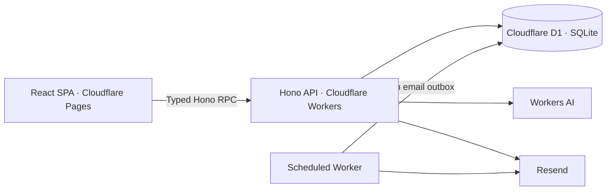

<div align="center">
  
  <h1>OhShift</h1>
  <p><strong>Plan the week. Keep your team in sync.</strong></p>
  <p>Employee scheduling, availability, time tracking, and team communication in one place.</p>

  [](https://github.com/allenjohn07/OhShifts/actions/workflows/verify.yml)
  [](https://github.com/allenjohn07/OhShifts/actions/workflows/deploy-cloudflare.yml)
  [](https://github.com/allenjohn07/OhShifts/actions/workflows/codeql.yml)

  <p><a href="https://ohshifts.com">Visit OhShift</a> · <a href="#getting-started">Get started</a> · <a href="docs/production-setup.md">Deployment guide</a></p>
</div>

---

OhShift helps owners and managers build schedules while giving employees a clear view of their week. Draft schedules stay private until publication, assignments are checked for conflicts, and team members can manage their availability and time off without a spreadsheet.

The application is under active development. See the [roadmap](.claude/plans/feature_roadmap_918c8bf8.plan.md) for planned work; the capabilities below describe the current implementation.

## What you can do

| Area | Capabilities |
| --- | --- |
| Scheduling | Weekly calendars, individual and bulk assignments, overlap detection, draft schedules, and week publication |
| Team management | Owner, manager, and employee roles; emailed invitations; employee deactivation that preserves work history |
| Availability & time off | Employee availability, time-off requests, and manager review |
| Time tracking | Shift clock-in/out, employee hours, and timesheet review |
| Communication | Announcements, direct messages with paginated history, and unread indicators |
| Transactional email | Resend invitations, single-use password recovery links, and queued schedule notifications |
| Ask OhShifts | Role-aware questions answered from company data, plus manager shift drafts that require confirmation |

## How it works

1. **Set up your team.** Register a company, invite employees by email, and assign manager permissions where needed.
2. **Build the schedule.** Review availability and time off, then assign shifts. Drafts are visible to managers and owners; conflicting assignments are rejected.
3. **Publish the week.** Employees can see their published shifts, and schedule emails enter a durable delivery queue.
4. **Keep work moving.** Employees clock in and out, request time off, and message their team. Managers review requests and timesheets.

Shared views refresh through TanStack Query polling, with immediate cache invalidation after local changes. API permissions and database queries are scoped to the signed-in user's company. Ask OhShifts reads permitted data; it does not modify records or publish schedules.

## Stack & architecture



| Layer | Technology |
| --- | --- |
| Frontend | React 19, TypeScript, Vite |
| Routing & server state | TanStack Router with file routes, TanStack Query |
| Interface | Tailwind CSS 4, shadcn/Radix, Lucide icons |
| API | Hono with typed RPC, Cloudflare Workers |
| Database | Cloudflare D1 (SQLite), Drizzle ORM and SQL migrations |
| Authentication | JWT sessions with server-side revocation, Web Crypto password hashing, expiring account links |
| Email & AI | Resend, Cloudflare Workers AI |
| Tooling | Bun, ESLint, TypeScript, Playwright, Miniflare/workerd, GitHub Actions, CodeQL |

## Getting started

### Prerequisites

- Bun and Node.js 22 (the version used in CI).
- A Cloudflare account for Wrangler authentication. The Workers AI binding uses the remote service even during local development.
- A verified Resend sender and API key if you want to exercise invitations or password recovery. Automated tests mock email delivery.

### Install

```bash
git clone https://github.com/allenjohn07/OhShifts.git
cd OhShifts
bun install
bun install --cwd backend
```

Create your local configuration from [`.env.example`](.env.example) and [`backend/.env.example`](backend/.env.example): frontend values go in `.env.local`, and Worker values go in `backend/.dev.vars`. Keep both files private and out of Git.

For local development, use `http://localhost:3000` for the app origin and `http://localhost:3001` for `VITE_API_URL`. Configure a local `AUTH_SECRET`, set `APP_URL` and `FRONTEND_URL` to the local app origin, and supply Resend credentials only when testing real email delivery.

### Start the API

```bash
cd backend
bunx wrangler login
bun run db:migrate:local
bun run dev
```

### Start the frontend

In a second terminal, from the repository root:

```bash
bun run dev
```

Open **http://localhost:3000**. The local API runs at **http://localhost:3001**; local migrations use Wrangler's local D1 database.

## Testing & quality

Install the browser once, then run the same verification used by CI:

```bash
bunx playwright install chromium
bun run verify
```

On Linux CI, use `bunx playwright install --with-deps chromium` to install browser system dependencies too.

| Command | Purpose |
| --- | --- |
| `bun run verify` | Lint, type checks, automated tests, production build, Worker/D1 checks, and browser tests |
| `bun run test` | Backend behavior and frontend helper tests |
| `bun run test:runtime` | Real local Workers runtime and D1 migration/integrity checks |
| `bun run test:browser` | Chromium interaction tests with a mocked API |
| `bun run build` | Type-check and build the frontend into `out/` |

Coverage includes permissions, company isolation, scheduling races, account recovery, session revocation, and key browser flows. Runtime tests use isolated bindings and intercept outbound email.

## Deployment

GitHub Actions verifies changes to `main`, applies D1 migrations, deploys the API Worker, and then uploads the frontend to Cloudflare Pages. The frontend waits for the API deployment to succeed.

| Component | Production target |
| --- | --- |
| Frontend | Pages project `ohshifts` · [ohshifts.com](https://ohshifts.com) |
| API | Worker `ohshift-api` |
| Database | D1 database `ohshift` |

Public frontend configuration comes from GitHub repository variables. Credentials belong in GitHub deployment secrets or Worker secrets, never in the frontend bundle. Cloudflare automatic Git builds should be disabled so Actions is the single deployment path.

See the [production setup guide](docs/production-setup.md) for Resend domain verification, required configuration, migrations, deployment checks, and operational guidance.

## Repository layout

```text
src/
  routes/             File-based route definitions
  features/           Product pages and feature components
  components/         Shared UI and application shell
  lib/                Typed API client, queries, and utilities
backend/
  src/routes/         API endpoints
  src/lib/            Authentication, email, scheduling, and AI logic
  src/db/             Drizzle schema and database client
  drizzle/            Versioned D1 migrations
  test/               Backend behavior and security tests
tests/                Frontend utility tests
e2e/                  Playwright browser scenarios
docs/                 Deployment and operations guides
.github/workflows/    Verification, deployment, and security analysis
```

## Development workflow

Start each task on a new branch from synchronized `main`. Include meaningful automated tests with features and regression tests with fixes, run `bun run verify` before committing, and keep cleanup scoped to the change. Root dependency installation activates Husky hooks; run `bun run prepare` in each new worktree.

See [AGENTS.md](AGENTS.md) for repository conventions and [production setup](docs/production-setup.md) for operational details.
